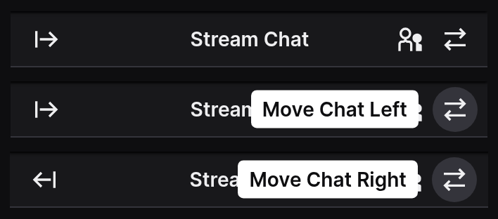

# Twitch Chat Side

Chromium extension that adds a button to the Twitch chat header for moving chat to the other side of the player, and moves it automatically depending on which monitor the window is on. The button looks and behaves like Twitch's own header buttons, tooltip included.

- **Needs [FrankerFaceZ](https://www.frankerfacez.com/).** The button flips FFZ's Swap Sidebars setting (Appearance > Layout), so it stays in sync with FFZ's menu and inherits FFZ's handling of theatre mode, the side nav and the collapse arrow. Without FFZ the button does not appear.
- **Per monitor:** when chat sits beside the player, chat moves to the side set for the monitor the window is on, and follows the window when you drag it to another monitor. Monitors are matched by name in `SCREEN_SIDES` at the top of `content.js`; the defaults put chat on the left on an LG UltraGear and on the right on a Samsung Odyssey Ark or an LG TV. Monitors that no rule names keep FFZ's saved setting.
- **Allow the prompt:** Chrome asks once whether twitch.tv may "manage windows on all your displays". That permission is what reveals the monitor's name. If the prompt does not appear on load, click the button once.
- **Per tab:** the monitor's side lives in a temporary FFZ profile for that tab only, so two Twitch windows on different monitors each get their own side and FFZ's saved settings are untouched. A click overrides it until the window changes monitor or layout.
- **Native look:** the button is cloned from Twitch's own collapse-chat button at runtime, so it picks up Twitch's current styles in light and dark themes.
- Hidden in watch parties, where FFZ does not swap, and in popout chat. In portrait layout, with chat below the player, the monitor rules do not apply.

Install: open `chrome://extensions` (or `vivaldi://extensions`), enable Developer mode, Load unpacked, pick this folder.

GPL-3.0.
